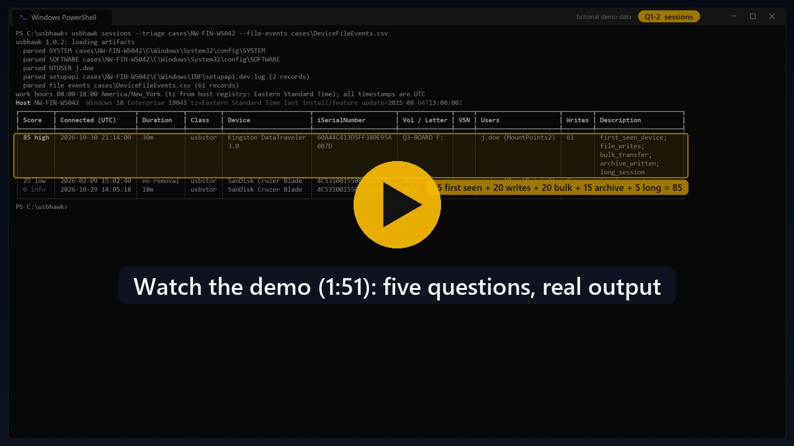
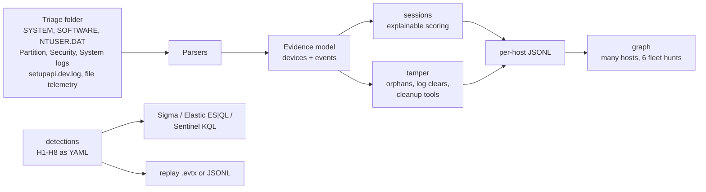

# USBHawk

```
   __  _______ ____  __  __               __
  / / / / ___// __ )/ / / /___ __      __/ /__
 / / / /\__ \/ __  / /_/ / __ `/ | /| / / //_/
/ /_/ /___/ / /_/ / __  / /_/ /| |/ |/ / ,<
\____//____/_____/_/ /_/\__,_/ |__/|__/_/|_|
   USB forensics for threat hunting & incident response
```

[](https://github.com/aakashraman/usbhawk/releases/latest)
[](pyproject.toml)
[](LICENSE)
[](https://github.com/aakashraman/usbhawk/releases/latest)

**Point USBHawk at a Windows triage collection (KAPE, Velociraptor, a mounted disk image or a live machine) and it
tells you which USB sessions look like data theft and why, whether someone wiped the USB evidence, where else each
stick has been, and how to catch it live next time.** Every answer comes with its reasons and the identifiers to
pivot on.

[](media/usbhawk-demo.mp4)

*The demo (1:51, no sound) runs `sessions`, `tamper`, `detections` and `graph` in PowerShell, one question each. All
hosts, users, devices and events in it are fictional; the highlight boxes are annotations, the rest is USBHawk's
real output.*

Most USB tools answer *"what devices were plugged in?"*. USBHawk answers the questions an investigation asks:

| Command | The question it answers | Demo |
|---|---|---|
| `usbhawk sessions` | Which USB sessions look like data exfiltration, and why? | [examples/sessions](examples/sessions/README.md) |
| `usbhawk tamper` | Did someone wipe the USB evidence, or did Windows clean it up? | [examples/tamper](examples/tamper/README.md) |
| `usbhawk detections` | How do we catch it live next time? (Sigma, Elastic, Microsoft Sentinel) | [examples/detections](examples/detections/README.md) |
| `usbhawk graph` | Where else has this stick been, and who else used it? (many hosts) | [examples/graph](examples/graph/README.md) |
| `usbhawk devices` | What was connected? (the classic 11-step USB device profile, as JSON) | [examples/sessions](examples/sessions/README.md#3-variations) |

New here? [The four use cases on one page](docs/USE-CASES.md) · [KAPE, Velociraptor and Elastic](docs/INTEGRATIONS.md)

Contents: [Install](#install) · [Try it](#try-it-in-two-minutes) · [Feed it evidence](#feed-it-evidence) ·
[The four tools](#the-four-tools) · [Workflows](#workflows) · [Pivot points](#pivot-points) · [Outputs](#outputs) ·
[How it works](#how-it-works) · [Validation](#validated-on-real-evidence) · [Docs](#documentation)

## Install

| | How | Needs |
|---|---|---|
| **Windows exe** | Download `usbhawk-<version>-windows-x64.zip` from [Releases](https://github.com/aakashraman/usbhawk/releases/latest), unzip, run `.\usbhawk.exe` | Nothing |
| **Python package** | Download the `.whl` from [Releases](https://github.com/aakashraman/usbhawk/releases/latest), then `pip install usbhawk-<version>-py3-none-any.whl` | Python 3.11+ on Windows, Linux or macOS |
| **From source** | `git clone https://github.com/aakashraman/usbhawk`, `cd usbhawk`, `py -3 -m venv .venv`, `.\.venv\Scripts\Activate.ps1`, `pip install -e ".[dev]"` | Python 3.11+ |

With the exe, type `.\usbhawk.exe` wherever this page says `usbhawk` (in PowerShell and in CMD). Each release ships
`SHA256SUMS.txt`; check your download against it. Step-by-step instructions for PowerShell and CMD, including the
hash check and adding USBHawk to `PATH`: [docs/GETTING-STARTED.md](docs/GETTING-STARTED.md).

## Try it in two minutes

The release zip and the repository include demo evidence. From the folder that contains `examples`:

```powershell
usbhawk detections run --events examples\detections\insider_timeline.jsonl   # an insider's evening: all 8 rules fire
usbhawk tamper --triage examples\tamper\wiped-host                           # a PC wiped with USBOblivion
usbhawk graph --runs examples\graph\fleet                                    # four hosts: all 6 fleet hunts fire
usbhawk graph --runs examples\graph\fleet device 60A44C41                    # everywhere one stick has been
```

Every tool has its own folder in **[examples/](examples/README.md)** with commands, the output you should see and how
to read it. The test suite runs every one of those commands, so the documented output is the real output.

## Feed it evidence

There is no format flag. `--triage <folder>` searches the folder and every subfolder and recognises the evidence **by
file name**, wherever it sits: the `SYSTEM` and `SOFTWARE` hives, each user's `NTUSER.DAT`, the
Partition/Diagnostic, Security and System event logs, `setupapi.dev.log`, and optionally EDR file events. Run it on
one host at a time.

| You have | Run |
|---|---|
| A **KAPE** collection (`--tdest D:\kape\WS042`) | `usbhawk sessions --triage D:\kape\WS042 --out runs\WS042` |
| A **Velociraptor** collection (`Windows.KapeFiles.Targets`, or an offline collector zip) | Extract it, then `--triage <extracted folder>`; encoded paths such as `uploads\auto\C%3A\...` are fine |
| A **disk image** (E01, raw/dd, VMDK, VHDX) | Mount it read-only (Arsenal Image Mounter, FTK Imager, `Mount-DiskImage`), then run KAPE against the mounted drive and use that folder, or `--triage F:\` directly (slower: it walks the whole volume) |
| A **live machine** you are responding on | Collect first with `scripts\collect_local.ps1` (elevated; `reg save` + `wevtutil epl`), then `--triage` the output: see [Live response](#c-live-response-on-a-running-machine) |
| Individual files | `--system`, `--software`, `--ntuser PATH=USER`, `--partition-log`, `--security-log`, `--system-log`, `--setupapi`, `--file-events` (these also override what `--triage` found) |

Good to know:

- **Several copies of a hive are fine.** Collections often include `config\RegBack` (empty since Windows 10 1803) and
  `Windows.old`. USBHawk always uses the live hive in `Windows\System32\config` and lists the others as `skipped`.
- **Hives copied from a running system are "dirty":** the newest changes, often the USB activity you want, sit in
  `SYSTEM.LOG1/.LOG2`. Replay them with Eric Zimmerman's `rla.exe` and pass the clean hives with `--system` /
  `--software`. `reg save` copies (as `collect_local.ps1` makes) are already clean.
- **Add EDR file events when you have them** (`--file-events`: a CSV from Microsoft Defender `DeviceFileEvents`,
  Sysmon event 11, CrowdStrike Falcon or LECmd). They are what show files being *written* to the stick.
- USBHawk only reads. It never changes the evidence, and makes no network calls.

## The four tools

### 1. `usbhawk sessions`: which USB sessions look like data theft, and why?

**What it does.** It merges the traces one plug-in leaves across the registry (`Enum\USB`, `USBSTOR`, `SCSI`, device
properties `0064/0066/0067`, MountedDevices, Portable Devices, EMDMgmt, MountPoints2), the Partition/Diagnostic log
(event 1006 on every connect and disconnect), the System and Security logs and `setupapi.dev.log` into **sessions**:
one device, connected at X, removed at Y. It attaches **who** was logged on, **what was written** to the stick
(from EDR file events on its drive letter during the session) and the **volume serials** seen, then scores each
session.

Devices covered: USB mass storage and card readers (`USBSTOR`), USB 3 disks using UAS (`Enum\SCSI`, like most
portable SSDs and drives), and phones and cameras over MTP (Windows Portable Devices, also when they enumerate
as composite devices). Keyboards, mice and other HID devices, hubs and webcams are profiled by `usbhawk devices`
and get sessions with `--all-classes`.

```powershell
usbhawk sessions --triage D:\kape\WS042 --tz America/New_York --out runs\WS042
usbhawk sessions --triage D:\kape\WS042 --file-events mde_files.csv --watchlist leavers.txt --allowlist approved.txt
```

```
Score     Connected (UTC)      Duration  Class    Device           Letter  VSN                Writes  Description
100 high  2026-10-30 21:14:52  26m       usbstor  Kingston DT 3.0  F:      8E2C41D7,11223344  61      first_seen_device; off_hours;
                                                                                                      file_writes; bulk_transfer;
                                                                                                      archive_written; reformat_or_repartition;
                                                                                                      watchlist_user
```

**How the score works.** Thirteen rules, each a behaviour that shows up in insider cases and can be proven from
offline evidence. Every rule that fires adds its points **and** a sentence of explanation:

| Rule | Points | Fires when |
|---|---|---|
| `first_seen_device` | +25 | The session contains the device's first-ever install on this host |
| `off_hours` | +15 | Connected outside work hours or on a weekend, judged on the **user's local clock** |
| `file_writes` | +20 | Any file written to the stick during the session |
| `bulk_transfer` | +20 | ≥ 50 files or ≥ 500 MB written |
| `archive_written` | +15 | `.zip .7z .rar .tar .gz .iso .pst .kdbx …` written |
| `reformat_or_repartition` | +25 | The volume serial or partition layout changed: the stick was reformatted |
| `mass_delete_on_device` | +10 | ≥ 50 deletes on the stick |
| `mtp_device` | +10 | A phone or tablet (MTP): no drive letter, a common DLP blind spot |
| `high_capacity` | +5 | Device ≥ 256 GB |
| `long_session` | +5 | Connected ≥ 30 minutes |
| `no_hardware_serial` | +5 | No iSerialNumber (Windows made up an ID): hard to track across hosts |
| `watchlist_user` | +30 | A user on `--watchlist` (leavers, people under investigation) was active |
| `allowlisted_device` | −50 | The serial is on `--allowlist` (approved company sticks) |

```
score    = clamp( sum of the points of every rule that fired, 0, 100 )
severity = high if score ≥ 70, medium if ≥ 40, low if ≥ 15, otherwise info
```

A transparent points model rather than machine learning, on purpose: every point is explained in words you can put
in a report (*"connected 2026-10-30 21:14Z = Fri 17:14 America/New_York, outside work hours"*), and every weight and
threshold is yours to tune in `config/scoring.toml`.

**What the score means.** It is a **triage priority, not a verdict**: it tells you which of hundreds of sessions to
read first. Read the reasons, not just the number: `off_hours + reformat + long_session` (someone hiding traces) and
`file_writes + bulk_transfer` (someone copying data) are different stories. Missing telemetry lowers scores: without
`--file-events` the four file rules cannot fire, so "low" is not "cleared".

All times are UTC; only the off-hours judgement uses a local clock (from `--tz`, the config, or the host's own
registry time zone, and the reason says which). Deep dive: [docs/hunt-exfil-sessions.md](docs/hunt-exfil-sessions.md).

### 2. `usbhawk tamper`: was the USB evidence wiped, or did Windows clean it up?

**What it does.** A stick leaves traces in many places and cleaners rarely get them all. USBHawk cross-checks those
places and, for each gap, asks what explains it. Windows itself purges old devices during feature updates (and
archives them in `DeviceMigration`); calling that anti-forensics would be a false accusation, so it is reported apart.

```powershell
usbhawk tamper --triage D:\kape\WS042 --out runs\WS042
```

On the included fictional wiped host (USBOblivion run by `m.ortiz`; the Description column shortened):

```
| Severity | Rule                        | Source Timestamp (UTC) | Description
| high     | orphaned_device_reference   | 2026-10-29 18:05:31    | USB serial 4C5300…8811 still appears in registry:EMDMgmt but is missing from Enum…
|          |                             |                        | USBOblivion was run by m.ortiz at 18:42:10Z, after this last reference
| high     | cleanup_tool_execution      | 2026-10-29 18:42:10    | USBOblivion (USBOblivion64.exe) was run by m.ortiz (registry:BAM: …\Downloads\…)
| medium   | partition_log_gap           | -                      | Partition/Diagnostic log is empty, yet the registry shows a USB disk arriving at 17:58
| low      | expected_artifact_missing   | -                      | setupapi.dev.log is missing although Windows\INF was collected
| info     | explained_by_feature_update | 2025-11-14 12:30:10    | missing from Enum, but a feature update came after its last reference: Windows cleanup
```

| Finding | Severity | Meaning |
|---|---|---|
| `cleanup_tool_execution` | high (USBOblivion) / medium (CCleaner, BleachBit, SDelete, …) | BAM recorded the tool running, with the user and time; log clears within 24 h after it are named |
| `log_cleared` | high for Security / System / Partition | Security 1102 or System 104 |
| `orphaned_device_reference` | medium; low for a volume GUID alone; **one level up** when a cleanup tool ran after it, **high** when a critical log was cleared within 24 h after it | A stick survives in the Partition log, MountedDevices, Portable Devices, EMDMgmt or MountPoints2 but its `Enum` keys are gone |
| `partition_log_gap` | medium | The Partition log is empty or restarts at record 1 although devices arrived after the current build, or record IDs jump |
| `expected_artifact_missing` | low | `setupapi.dev.log` gone (Windows always keeps it; USBOblivion deletes it) |
| `explained_by_feature_update` | info | The benign twin: a feature update or `DeviceMigration` explains the gap |
| `evidence_host_mismatch` | info | A log in the folder was written by another computer; its devices are kept out of the checks |
| `orphan_checks_skipped` | info | No SYSTEM hive, so orphans cannot be judged; never guessed |

Lab-verified against USBOblivion 1.17.0 on Windows 10, cross-checked with RECmd and EvtxECmd: every wiped stick,
cleared log and tool run reported, zero false positives. Deep dive: [docs/hunt-usb-tamper.md](docs/hunt-usb-tamper.md).

### 3. `usbhawk detections`: catch it live next time

**What it does.** The hunts' ideas, written once as eight hypotheses with their own test events, generated for
**Sigma**, **Elastic (ES|QL, plus a Kibana import)** and **Microsoft Sentinel / Defender XDR (KQL)**. Before you deploy
anything, `detections run` replays real logs (or SIEM exports) through the rules offline and shows what would have
fired.

| | Detects | ATT&CK |
|---|---|---|
| H1 | USB storage connected; a stick never seen before | T1052.001, T1200 |
| H2 | USB storage connected outside work hours | T1052.001 |
| H3 | Bulk file copy to removable media (≥ 50 files in 10 minutes) | T1052.001 |
| H4 | An archive written to removable media | T1560, T1052.001 |
| H5 | A disk formatted or repartitioned from the command line | T1070, T1561 |
| H6 | A USB history cleaner or general cleaner runs | T1070, T1685.005 |
| H7 | An event log cleared (1102, 104, `wevtutil cl`, `Clear-EventLog`) | T1685.005 |
| H8 | USB device history deleted from the registry | T1070, T1112 |

```powershell
usbhawk detections test                                  # every rule against its must-match / must-not-match events
usbhawk detections build --out rules                     # 37 files: Sigma YAML, ES|QL + Kibana ndjson, KQL
usbhawk detections run --evtx D:\kape\WS042 --removable-drives F: --out runs\WS042
```

```
| Event Timestamp (UTC) | Hypothesis | Detection           | Level  | Description
| 2026-10-30 21:16:00   | H3  | bulk_copy_to_usb           | high   | 60 matching events between 21:16:00Z and 21:19:56Z (threshold 50 per 10 min)
| 2026-10-30 21:39:00   | H6  | usb_cleaner                | high   | process_name=USBOblivion64.exe; command_line=USBOblivion64.exe -enable -auto
| 2026-10-30 21:40:01   | H7  | security_log_cleared       | high   | channel=Security; event_id=1102; cleared_log=Security; user=NW\j.doe
```

The table is a timeline; the **Look at first** block under it lists the alerts by level (high first), and the
story reads device (H1, H2), copying (H3, H4), cleanup (H5 to H8). `--config my_scoring.toml` keeps the live rules'
thresholds and work hours identical to the offline hunt's.

Windows records little of this by default: H1/H2 need PnP auditing (6416), H3/H4 and H8 need Sysmon (or Defender),
H5/H6 need process creation. Every replay ends with a **Telemetry gaps** note naming the hypotheses that could not
fire, so zero alerts never reads as "nothing happened". How to turn the telemetry on:
[docs/GETTING-STARTED.md](docs/GETTING-STARTED.md#turn-on-the-telemetry-the-rules-need). Deep dive:
[docs/hunt-detection-rules.md](docs/hunt-detection-rules.md).

### 4. `usbhawk graph`: where else has this stick been, and who else used it?

**What it does.** It reads the `--out` folders of `sessions` and `tamper` from many hosts and recognises the same
stick everywhere: by its **real serial** (high confidence), then a shared **volume serial** (medium), then **volume
name and capacity** (low). Cheap sticks that share a fake serial are never merged on it. No IP addresses or network
data: the identifiers are the ones Windows recorded about the stick on each host, so the hosts can be offline
([identity](docs/hunt-fleet-device-graph.md#no-network-data-the-stick-is-its-own-fingerprint); collecting a domain:
[INTEGRATIONS](docs/INTEGRATIONS.md#many-hosts-on-an-active-directory-domain)). Then it runs six fleet hunts:

| Hunt | Finds |
|---|---|
| `exfil_device_spread` | A stick with a high-risk session (score ≥ 70) on one host was also on others: where the data went, or came from |
| `wiped_here_seen_there` | A stick wiped on one host is still recorded on another: collect that host |
| `device_on_many_hosts` | One stick moving between machines |
| `device_shared_by_users` | One stick used by several people |
| `new_to_fleet` | First time this stick appears anywhere in the fleet |
| `serial_collision` | Two different sticks report the same fake serial: not linked |

```powershell
usbhawk graph --runs runs --out fleet          # findings + graph.json, graph.graphml (Gephi/yEd), graph.cypher (Neo4j)
usbhawk graph --runs runs device 60A44C41      # where has this stick been (serial, name or volume serial)
usbhawk graph --runs runs user j.doe           # every stick one person touched, on any host
```

```
Kingston DataTraveler 3.0 (60A44C413D5FF380E95A0B7D) | 3 host(s) | match: serial (high)
| Host         | First / Last Seen (UTC) | Sessions | Users   | Top score | Writes | Volumes / VSN     |
| NW-FIN-WS042 | 2026-10-30 21:14        | 1        | j.doe   | 85 high   | 61     | Q3-BOARD 8E2C41D7 |
| NW-HR-WS007  | 2026-10-31 21:14        | 1        | a.smith | 0 info    | 0      | 8E2C41D7          |
| NW-ENG-LT113 | 2026-11-02 21:14        | 1        | k.lee   | 0 info    | 0      | -                 |
```

Deep dive: [docs/hunt-fleet-device-graph.md](docs/hunt-fleet-device-graph.md).

## Workflows

### A. Incident response on one host

1. Collect (KAPE, Velociraptor, mounted image) and run both host tools into one folder:
   `usbhawk sessions --triage <evidence> --out runs\WS042` and `usbhawk tamper --triage <evidence> --out runs\WS042`.
2. **Triage** the sessions: high first, then medium; read the Description, not just the score.
3. **Check for a cover-up**: a high session followed by `cleanup_tool_execution` or `log_cleared` is a far stronger
   case than either alone.
4. **Build the timeline** from `sessions.csv` (Excel) or `sessions.jsonl` (SIEM): exact UTC connect and remove times,
   the user, the files written. Line them up with logons, e-mail, cloud uploads and EDR process events.
5. **Note the pivots** (serial, volume serial, volume name, drive letter, user) and follow them to other hosts.

### B. Threat hunt across a fleet

Collect the same small set of files from every endpoint (a Velociraptor hunt with `Windows.KapeFiles.Targets`, or
KAPE), run the host tools per host, then link them:

```powershell
Get-ChildItem D:\hunt\collections -Directory | ForEach-Object {
    usbhawk sessions --triage $_.FullName --out "runs\$($_.Name)" -q
    usbhawk tamper   --triage $_.FullName --out "runs\$($_.Name)" -q
}
usbhawk graph --runs runs --out fleet
```

Start from the fleet hunts (`exfil_device_spread`, `wiped_here_seen_there`), pivot with `device` and `user`, and load
`graph.cypher` into Neo4j or `graph.graphml` into Gephi to see the picture.

### C. Live response on a running machine

USBHawk analyses collected evidence; on a live Windows machine, collect first. From an elevated PowerShell, writing
to your IR drive (not the evidence disk):

```powershell
powershell -ExecutionPolicy Bypass -File scripts\collect_local.ps1 -Out E:\IR\WS042
usbhawk sessions --triage E:\IR\WS042 --out E:\IR\WS042-out
usbhawk tamper   --triage E:\IR\WS042 --out E:\IR\WS042-out
usbhawk detections run --evtx E:\IR\WS042 --out E:\IR\WS042-out
```

`collect_local.ps1` (in the release zip) saves clean hive copies with `reg save`, exports the Partition/Diagnostic,
Security, System and (if installed) Sysmon logs with `wevtutil epl`, and copies `setupapi.dev.log`, noting when it is
missing. It collects the hives of the user running it; for every profile on the machine use KAPE. `detections run`
on the exported logs shows what the rules would have caught on this machine; log files it cannot open are listed and
skipped, never fatal.

### D. Detection engineering and the SIEM

- Deploy the generated rules: `usbhawk detections build --out rules`, then import `rules\elastic\usbhawk_rules.ndjson`
  into Kibana, paste the KQL into Sentinel analytics rules, or convert the Sigma rules with your own pipeline.
- Test them first on your own logs with `detections run --evtx`, or on SIEM exports converted to the neutral event
  format with `detections run --events`.
- Ingest the hunt results: `sessions.jsonl`, `tamper.jsonl` and `findings.jsonl` use ECS field names
  (`@timestamp`, `event.*`, `host.name`, `user.name`, `usb.device.*`, `usbhawk.*`).

## Pivot points

What USBHawk gives you to follow next, and where to take it:

| Pivot | From | Take it to |
|---|---|---|
| **iSerialNumber** (`usb.device.serial`) | sessions, devices, tamper orphans | `usbhawk graph … device <serial>`; other hosts' `USBSTOR`, Portable Devices, EMDMgmt; EDR USB device events |
| **Volume serial number** (`usb.device.vsns_all_time`) | Partition log 1006, EMDMgmt | LNK and JumpList files (they record the volume serial): which files were opened from the stick; `graph` links by it |
| **Volume name** (`volume_names`) | Portable Devices, EMDMgmt | Shortcuts, recent-file lists, other hosts |
| **Drive letter + session window** | sessions (`drive_letters`, Connected + Duration) | EDR file events, Sysmon 11, Security 4663 in that window: what was written |
| **User** (`user.name`) | sessions (MountPoints2), tamper (BAM, MountPoints2) | `usbhawk graph … user <name>`; logon events; the user's other hosts |
| **Volume GUID** | MountPoints2, MountedDevices | Which user mounted which volume |
| **Cleanup tool run** | tamper (BAM path and time) | Prefetch, Amcache, EDR process events: what ran before and after |
| **Host + time** | every finding | Proxy, e-mail and cloud logs around the session |

## Outputs

| File | From | Format |
|---|---|---|
| `sessions.jsonl` | `sessions` | ECS, `event.dataset: usbhawk.session`; one session per line with every reason |
| `sessions.csv` | `sessions` | One row per session with its reasons (Excel, timelines) |
| `devices.jsonl` | `sessions`, `devices` | The USB device profile per device; also the fleet graph's input |
| `tamper.jsonl` | `tamper` | ECS, `event.dataset: usbhawk.tamper` |
| `alerts.jsonl` | `detections run` | One alert per line: hypothesis, detection, level, description, evidence |
| `findings.jsonl`, `graph.json`, `graph.graphml`, `graph.cypher` | `graph` | ECS findings; the graph for scripts, Gephi/yEd and Neo4j |
| `rules\sigma`, `rules\elastic`, `rules\sentinel` | `detections build` | Deployable rules |

Every command explains itself: `usbhawk <command> --help` shows the question it answers, its options, examples, the
files it writes and its guide.

## How it works



- **Explainable by design.** Every score and finding carries the rule, the points and a sentence of description.
- **UTC everywhere.** Table headings say which time they show: when a device was *connected*, the timestamp recorded
  in the *source* artifact, the *event* time in a log, or when a stick was *first and last seen*.
- **Careful about absence.** A missing trace is only called tampering when nothing benign explains it (a Windows
  feature update, a log from another machine), and the finding names the artifact that survived.
- **One source for hunting and detection.** The live rules mirror the offline hunts, and a reference evaluator makes
  every generated rule match the same test events.

More: [docs/REFERENCE.md](docs/REFERENCE.md) (every artifact parsed, time zones, known limitations).

## Validated on real evidence

| Evidence | Result |
|---|---|
| Public sample hives and logs (regipy, Partition-4DiagnosticParser) | Sessions, reformatted sticks and a mixed-machine triage folder detected; run by the test suite |
| Windows 10 VM, wiped with USBOblivion 1.17.0 | Every wiped stick, cleared log and tool run reported; zero false positives; cross-checked with Eric Zimmerman's RECmd and EvtxECmd |
| Sysmon + Security lab telemetry | Detection replay counts match EvtxECmd |
| Two real machines sharing one USB disk | The disk linked across both by its serial |
| [NIST CFReDS Data Leakage case](examples/real-evidence/README.md) (Windows 7) | Both USB sticks of the answer key found with the right serials, user and first-connection times; no false tamper or detection alerts over 2,833 events |
| EVTX-ATTACK-SAMPLES | The real Security 1102 and System 104 records fire H7 and `log_cleared` |

What it does **not** catch yet (Windows 7 reconnections, volume labels without a device path, and more) is listed
in [docs/TESTING.md](docs/TESTING.md), with a plan for each in [ideas/](ideas/README.md).

## Documentation

| Doc | Contents |
|---|---|
| [docs/USE-CASES.md](docs/USE-CASES.md) | The four use cases on one page: the question, the command, the output, what it means, where to pivot |
| [docs/GETTING-STARTED.md](docs/GETTING-STARTED.md) | Install (PowerShell and CMD), demo, KAPE / Velociraptor / disk images / live machines, many hosts, live rules, SIEM output, troubleshooting |
| [docs/INTEGRATIONS.md](docs/INTEGRATIONS.md) | Worked examples with KAPE, Velociraptor (one host and fleet hunts) and Elastic (rule import, shipping results with Filebeat, KQL pivots) |
| [examples/](examples/README.md) | One folder per tool: demo commands, expected output, how to read it |
| [docs/hunt-exfil-sessions.md](docs/hunt-exfil-sessions.md), [hunt-usb-tamper](docs/hunt-usb-tamper.md), [hunt-detection-rules](docs/hunt-detection-rules.md), [hunt-fleet-device-graph](docs/hunt-fleet-device-graph.md) | One deep guide per tool: logic, every finding, lab results, limits |
| [docs/REFERENCE.md](docs/REFERENCE.md) | How it works, scoring rules, time zones, every artifact parsed, known limitations |
| [docs/TESTING.md](docs/TESTING.md) | Test layers, test inventory, lab procedures, real-data validation |
| [docs/ROADMAP.md](docs/ROADMAP.md), [ideas/](ideas/README.md) | What is done, what is next, one file per idea |
| [CHANGELOG.md](CHANGELOG.md) | Releases |

## Repository layout

```
src/usbhawk/          the package: parsers/, sessions + scoring, tamper, detections/ (rules + generators), graph, cli
examples/             one demo folder per tool (sessions, tamper, detections, graph, real-evidence)
docs/                 getting started, reference, one guide per tool, testing, roadmap
tests/                one folder per tool, plus shared foundations and the demo kit
scripts/              live collection, sample and dataset fetchers, demo generator, release build and smoke test
config/scoring.toml   work hours, thresholds and weights for session scoring
ideas/                future work, one file per idea
```

## Testing

Every tool is tested in three layers before it ships: automated tests (`pytest -q`), runs on public evidence, and lab
tests on a throwaway VM cross-checked with Eric Zimmerman's tools. Every documented sample output, including every
command in `examples/`, is backed by a test. Details: [docs/TESTING.md](docs/TESTING.md).

```powershell
pip install -e ".[dev]"
python scripts\fetch_test_samples.py    # public sample hives and logs into tests\data (never committed)
pytest -q
```

## Contributing

Issues and pull requests are welcome. Contributor notes (architecture rules and the forensic gotchas already handled)
are in [CLAUDE.md](CLAUDE.md). Please never attach real case data to an issue; a minimal fictional reproduction is
always enough.

## Credits and references

Methodology: SANS FOR500. Research: Yogesh Khatri (device property timestamps), Nicole Ibrahim (MTP/PTP),
Kevin Ripa (USB serial numbers), David Cowen and Phill Moore (DeviceMigration). Prior art: USB Detective (Jason Hale),
parseusbs (Kathryn Hedley), Partition-4DiagnosticParser (theAtropos4n6). Parsers: regipy, evtx (pyevtx-rs).
Public test data: regipy test hives, the Partition-4DiagnosticParser sample, NIST CFReDS, EVTX-ATTACK-SAMPLES
(fetched on demand, never bundled).

Use USBHawk only on systems and evidence you are authorised to examine.

[MIT License](LICENSE).
